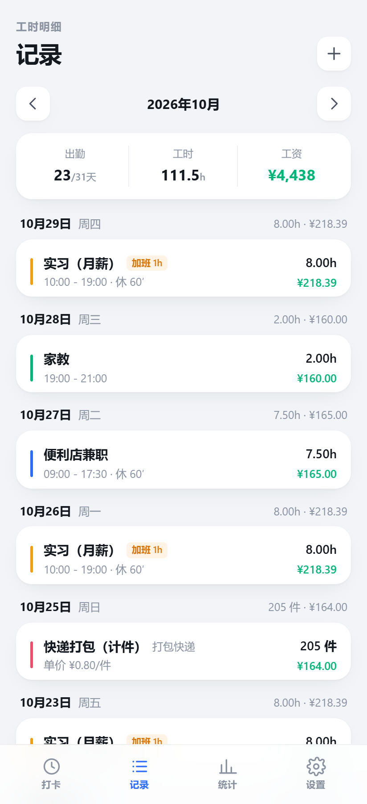
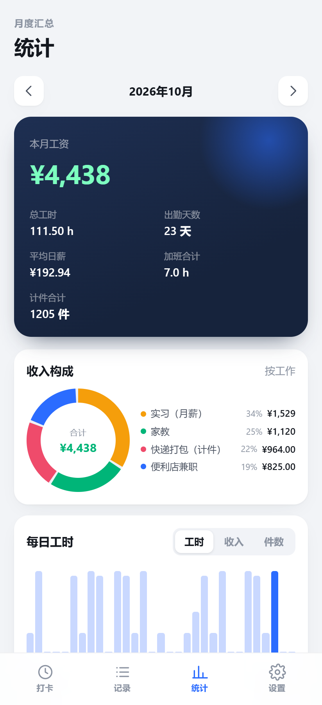

# 工时账本

> 一个纯离线的安卓小工具：记工时、算工资、看统计。数据只存在手机本地，不联网、不上传。

[](./LICENSE)

| 打卡 | 记录 | 统计 |
| :--: | :--: | :--: |
|  |  |  |

## 功能

- **打卡计时**：选工作 → 上班打卡 → 下班打卡，自动算工时并记账
- **手动补录**：选日期、上下班时间、休息分钟数、加班小时，实时预览工时和工资；计件工作可只填件数，也可同时记录上下班时间
- **工资计算**：支持时薪 / 日薪 / 月薪 / 计件
  - 时薪：实发小时数 × 单价
  - 日薪：按每日标准工时折算成时薪
  - 月薪：`月薪 ÷ 计薪天数 ÷ 每日工时` 折算成时薪
  - 计件：`件数 × 单价`
  - 加班：单独按倍率计算
- **多份工作**：可添加多份兼职/项目，各自独立的薪资规则和颜色标记
- **月度统计**：总工时、总工资、出勤天数、平均日薪、加班合计、计件件数；每日柱状图（工时 / 收入 / 件数切换）；按工作拆分的收入环形图与占比
- **数据导出**：导出本月 / 全部 CSV（带 BOM，Excel 可直接打开），或导出 JSON 完整备份；支持从备份恢复
- **纯本地存储**：数据保存在 WebView 的 localStorage，App 未申请 `INTERNET` 权限

## 技术栈

| 层 | 选型 |
| --- | --- |
| 前端 | React 19 + TypeScript + Vite |
| 样式 | 手写 CSS（无 UI 框架），图表为纯 CSS / SVG |
| 打包 | Capacitor（`@capacitor/filesystem`、`@capacitor/share`） |
| 平台 | Android，minSdk 24 / targetSdk 36 |

## 开发

```bash
npm install
npm run dev      # 浏览器调试，建议开手机尺寸（如 412×900）
npm run lint     # oxlint
npm run build    # tsc + vite build，产物在 dist/
```

开发模式下可加参数快速预览：

- `?demo=1`：灌入一批演示数据（`import.meta.env.DEV` 守卫，生产包不包含）
- `#records` / `#stats` / `#settings`：直接打开指定 Tab

## 打包 APK

前置条件：JDK 21、Android SDK，并设置 `ANDROID_HOME`（或在 `android/local.properties` 写 `sdk.dir`）。

```bash
npm run sync         # 构建前端并同步到安卓工程
npm run apk          # 正式包 → android/app/build/outputs/apk/release/app-release.apk
npm run apk:debug    # 调试包
```

### 签名

正式签名信息从 `android/keystore.properties` 读取，**该文件与密钥库都不纳入版本库**。首次打包 release：

```bash
cp android/keystore.properties.example android/keystore.properties
# 编辑：storeFile / storePassword / keyAlias / keyPassword
```

没有 `keystore.properties` 时，release 构建会产出未签名 APK，debug 构建不受影响。

> 已发布过的包升级覆盖安装必须使用同一密钥库；换密钥库只能卸载重装。

### 修改应用标识

`appId` / `appName` 同时出现在 `capacitor.config.ts` 与 `android/app/build.gradle`（`namespace`、`applicationId`），改完记得 `npm run sync`。

## 目录结构

```
src/
  screens/      打卡 / 记录 / 统计 / 设置 四个页签
  components/   底部弹层、工时表单、工作表单、图标
  lib/          本地存储、工资计算、时间工具、导入导出、演示数据
docs/           截图等文档资源
android/        Capacitor 生成的安卓工程
tools/          重新生成应用图标 / 启动图的 PowerShell 脚本
```

## 数据与隐私

- 所有记录只写入本机 WebView 的 localStorage，不上传任何服务器
- `AndroidManifest.xml` 中移除了 `INTERNET` 权限，App 无法联网
- 卸载 App 或「设置 → 清空全部数据」会删除数据，建议定期「导出完整备份」

## 常见问题

**项目路径含中文时 Gradle 报错？**
`android/gradle.properties` 里已配置 `android.overridePathCheck=true`，保留即可。

**浏览器里改了代码但手机上是旧的？**
`npm run apk` 已经包含 `cap sync`；如果只改了前端，至少执行一次 `npm run sync`。

## 许可证

本项目使用 **GNU General Public License v3.0** 开源，详见 [LICENSE](./LICENSE)。

```
Copyright (C) 2026 工时账本 contributors

This program is free software: you can redistribute it and/or modify
it under the terms of the GNU General Public License as published by
the Free Software Foundation, either version 3 of the License, or
(at your option) any later version.
```
